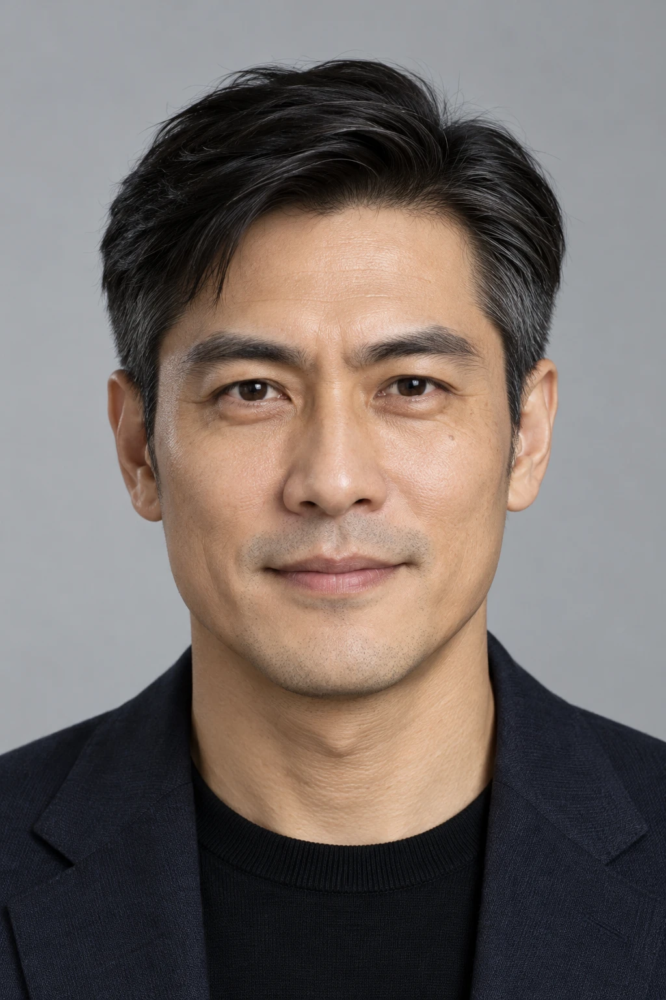

# model-cast

**用自然语言设计一位成年虚拟模特，确认后保存，交给裁光拍商品。**

Describe an adult fictional model, review a candidate, save the accepted identity, and reuse it in Caiguang.

`v0.1.0-beta.1` · Source prerelease · Codex · MIT code / CC0 public seeds

说需求 → 一张候选 → 按反馈修改 → 确认保存 → 裁光读取人物包。

这是有人工确认的工作流。它复用 [裁光 · Caiguang](https://github.com/denggui-ai/threadtruth-studio) 的人物包接口；不需要改动裁光代码。没有商品图时也能先设计人物。

## 现在可以做什么

- 用用途、气质、参考或日常语言设计人物，不要求用户填写五官参数或 JSON。
- 从文字生成一张候选，或保存已接受的 AI 人物原图；修改时说明保留与改变的范围。
- 保存原始身份、可调条件、造型锁与实际接受范围；新表现可以作为补充。
- 选择两位公共种子 Lina、Jun。它们是共享素材，不是独家模特。
- 将人物包交给裁光，通过现有 `model_package` 入口拍摄真实商品。

| Lina · AI fictional adult | Jun · AI fictional adult |
|---|---|
|  |  |

上述图片是公共身份参考，**不是本次私人 POC 的人物或成片**。卡片中的年龄、地区、肤色分类与身高是虚构设计描述，不能当作真实身份或测量结果。各角度的发型和动作也可能不同。

## 验证到哪里

维护者已完成一条限定 POC：已有 AI 正脸 → 私人人物包 → 裁光 beta.18 导入 → 一张商品图 → 用户接受人物复用。商品主要结构通过初审，留白、光比和细微材质仍待核。没有修改裁光代码。

这不证明任意文字需求都能一次得到满意面孔，也不保证跨商品锁脸、精确尺码或商业全项 QA。私人 POC 的人物和第三方商品素材不在公开仓库中。[验证范围](docs/VERIFICATION.md)。

## 开始使用

需要支持本地技能的 Codex、Python 3.9+、Pillow，以及已安装的 [裁光 beta.18](https://github.com/denggui-ai/threadtruth-studio/releases/tag/v1.0.0-beta.18)。生成时还需要宿主原生 `image_gen` 和可用账户额度。脚本没有独立的生图 API，也不要求填写 API key。

本机验证环境为 macOS arm64、Python 3.14、Pillow 12.1.1。Linux 尚未验证；原生 Windows 不支持当前 `fcntl` 账本。其他 Codex 宿主、版本与新机器发现流程尚未实测。

先下载本次标签的源码，再按 [离线使用指南](USER-GUIDE.html) 核对依赖与校验值。只复制 `skills/model-cast` 到本地技能目录；不要把整个仓库当成运行技能。

在源码仓库目录运行以下命令会安装技能；如果目标已经存在，它会停止，先按指南备份旧版：

```sh
python3 - <<'PY'
from pathlib import Path
import shutil
source = Path('skills/model-cast')
target = Path.home() / '.agents/skills/model-cast'
if not (source / 'SKILL.md').is_file():
    raise SystemExit('Run this from the downloaded model-cast source directory.')
if target.exists() or target.is_symlink():
    raise SystemExit('Existing installation found. Back it up before replacing it.')
target.parent.mkdir(parents=True, exist_ok=True)
shutil.copytree(source, target)
print(target)
PY
```

本地发现位置参考 [OpenAI 技能文档](https://learn.chatgpt.com/docs/build-skills#where-to-save-skills)。在新聊天中查看技能列表；未出现时重启 Codex。这次发布没有改动你的全局配置，也不自动安装裁光或 Python 依赖。

安全的第一句话：

> 用 $model-cast 帮我设计一位给通勤女装拍图的成年虚拟模特，先聊人物方向，不生成图片。

预期得到一个简短方向和必要的关键澄清，不调用生图。缺少裁光时仍可聊方案；保存与生成需先补齐接口。准备好后再说“按这个方向生成一张候选，我确认后保存”。

## 数据与许可

私人任务位于技能仓库外，保留原图、请求、账本、候选与人物包；默认不会自动删除或公开。实际生成会将提示词与所选参考交给宿主的 OpenAI 生图服务，费用、配额和服务端留存由宿主账户政策决定。脚本没有网络请求或遥测；在 Codex 中的对话和文件读取仍受宿主数据政策约束。

代码和说明使用 [MIT](LICENSE)。两位公共种子的图片、卡片与索引沿用 [CC0-1.0](skills/model-cast/roster/LICENSE-CC0.txt)。裁光是独立依赖，遵守其自身许可。私人输入与生成结果不会因为保存或使用本项目而被授予 CC0；第三方权利也不会被此许可覆盖。人物是 AI 虚构成年人，不保证与现实人物绝无相似。

## 开发与反馈

运行时位于 `skills/model-cast`；测试、评测定义和发布说明留在仓库根目录。脚本的 `--threadtruth` 必须指向实际可用的裁光技能目录，不能填插件容器的父目录。完整命令见 [私人流程](skills/model-cast/references/private-workflow.md)。

安装测试依赖后，指定裁光目录并执行：

```sh
python3 -m pip install -r requirements-dev.txt
MODEL_CAST_THREADTRUTH="$THREADTRUTH" PYTHONDONTWRITEBYTECODE=1 python3 -m pytest -q -p no:cacheprovider
```

`THREADTRUTH` 由你填入实际路径。未设置时依赖裁光的测试会跳过，不能把跳过计为通过。测试使用合成色块，不会生图或证明视觉质量。

[使用、升级与卸载指南](USER-GUIDE.html) · [验证范围](docs/VERIFICATION.md) · [变更记录](CHANGELOG.md) · [提交问题](https://github.com/denggui-ai/model-cast/issues)

反馈只需版本、系统、操作和脱敏错误；请勿上传私人脸图、完整提示词、密钥或账户信息。
