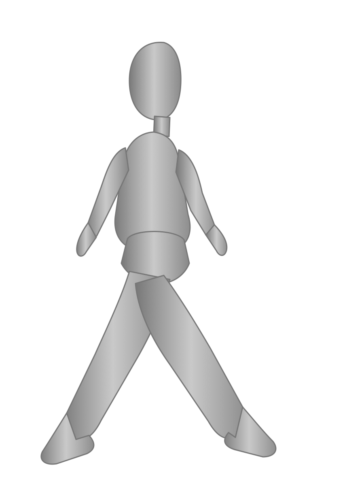
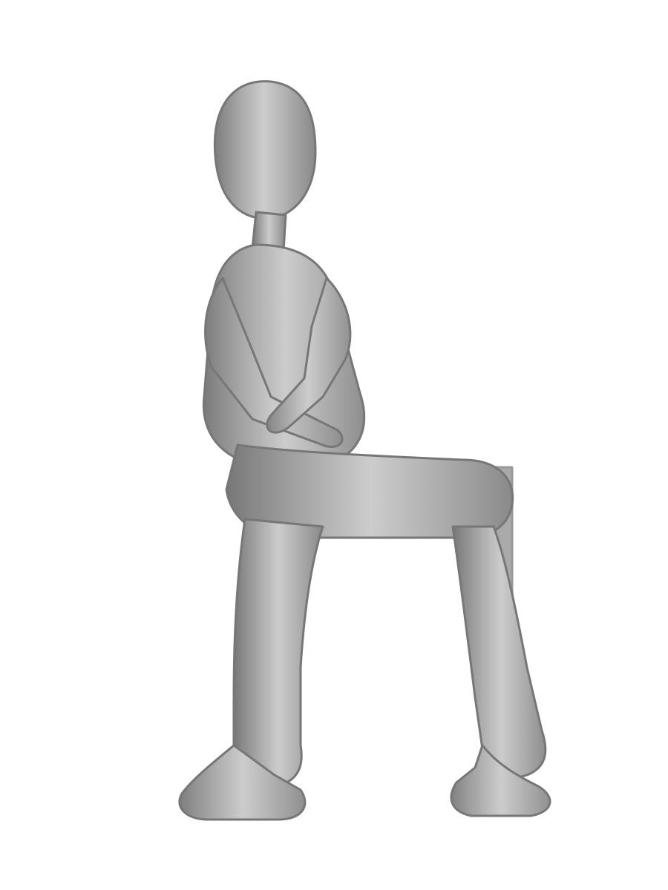
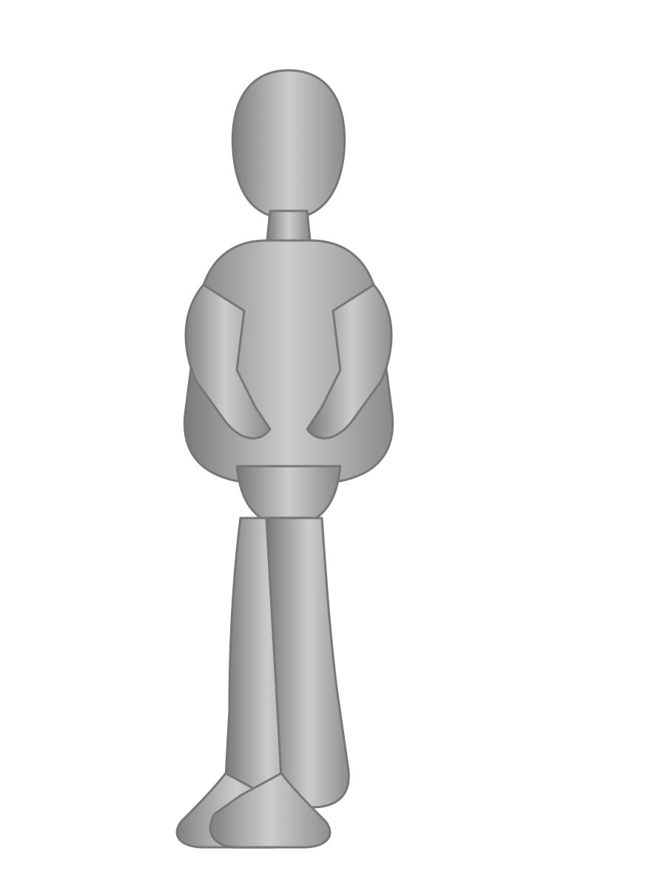

# model-cast

**Create an original AI fashion model for a product line — then deliver a reusable set of images that helps AI recognize and reuse that model.**

[简体中文](README.zh-CN.md) · **English**

model-cast starts from the seller's product and casting brief. It helps select an original adult fictional model, get the Owner's approval of her face and body, and prepare a visual reference package for downstream AI work.

## What you actually get

The end product is **a model identity package and its visual reference library** — not a mannequin, not a set of drawings, and not a finished clothing advertisement.

### 1. The model: one approved identity

The Yuning example below shows the kind of identity output: a consistent face reference and an approved full-body reference.

| Face identity | Approved full-body |
|---|---|
|  |  |

### 2. The model's visual library

The identity is expanded into views and selected actions so downstream AI can refer to the same model from more than one angle.


**C6 delivers:** 12 model views and three selected action/expression examples (walking, sitting, natural smile). These are the model's actual visual references; views without a visible face help with body direction and framing, not facial identity.

### 3. Camera and pose guides

These are supporting guides for the model library. They are not the product's main output and they do not replace the model's real reference photos.

**N2 — camera direction and framing**


N2 uses a faceless grey mannequin to make camera direction, view angle and crop easier to communicate. It is a camera/framing guide — not a model, not a face reference, and not a clothing template.

**C10 — optional body poses**

| Side walking | Side sitting | Hands-in-pockets |
|---|---|---|
|  |  |  |

C10 uses the same faceless grey-mannequin visual language as N2, but has a different job: it shows limb positions and body action. It was added to `main` after v0.2.0; it is not in the v0.2.0 release archive or existing V3.0 seller package.

## Why this is different

The core value is **not the mannequin style**. It is the end-to-end process of selecting an original model for a product line, locking the approved identity, and handing off a structured set of model images that can be reused.

- **C6 is the model.** It carries the approved face, body proportions and real model views.
- **N2 is the camera guide.** Its grey mannequin communicates camera direction and framing.
- **C10 is the pose guide.** Its grey mannequin communicates body action and limb positions.
- **The product photo is a separate input.** It informs the downstream task about the product; it does not define the model's identity.

The grey mannequin is a practical visual language for camera and pose instructions. It is not the final deliverable and should not be mistaken for the AI model itself.

## What is included in this public repository

- The `skills/model-cast/` Skill and its workflow instructions.
- Scripts, reference templates, and package-building/validation tools.
- Public Yuning example images shown above.
- The C6/N2/C10 reference definitions and the ChatGPT/Codex handoff workflow.
- A separate Lookset D2 adapter.

The repository contains the reusable source and public examples. Owner-specific V3.0 seller packages and private RUN records are not published as public release assets.

model-cast is not an image-generation service, virtual try-on system, clothing-design tool, or commercial photography pipeline. Final image generation and garment fidelity depend on downstream tools and the user's workflow.

## Quick start

### 1. Install

```sh
git clone https://github.com/denggui-ai/model-cast.git
cd model-cast
python3 -m venv .venv
. .venv/bin/activate
python3 -m pip install -r requirements-dev.txt
shasum -a 256 -c SHA256SUMS
```

### 2. Install the Skill

Install only `skills/model-cast` into your supported agent skill directory. Back up any existing installation first; this repository does not overwrite an existing installation automatically.

### 3. Start a project

Try this prompt:

> Use model-cast to create an original adult virtual fashion model for my product line. First inspect the inputs and propose the casting plan; do not generate images until I approve.

Image generation requires the host's native image capability, account access, and explicit user authorization. This Skill does not bundle an image model or provide generation credits.

## Example: Yuning

Yuning is an AI-generated fictional model, not a photograph of a real person. The Owner authorized the selected images below for this public project showcase.

| Face identity reference | Approved front full-body reference |
|---|---|
|  |  |

The C6 overview documents 12 model views and three action/expression examples. Owner visual feedback accepted the 13 supplementary outputs. Views without a visible face are body/framing references, not facial-identity proof.


### N2 camera/framing guide

N2 contains 12 faceless, hairless, clothing-free grey mannequin views. It communicates camera direction and framing/crop; it is not Yuning, a clothing drawing, or an image-edit base.


## Downstream workflows

### ChatGPT or Codex

The seller pack includes `4_完整AI资料库（多文件上传）` / `4_AI_Model_Library_MultiUpload`. Upload the files together when using the full library. It contains 12 model views (including four core identity anchors), three accepted action/expression examples, N2, `START-HERE.md`, and `asset-index.json`.

The index explains each asset and helps the AI select the smallest relevant reference set. A four-image lightweight set remains available in `2_上传给AI` / `2_Upload_to_AI`.

**Host limitation:** recognizing or selecting an uploaded image does not prove that a downstream image-generation/editing tool received it as a reference. ChatGPT recognized 16/16 assets in a multi-file test, and limited pose-generation checks were performed. Independent identity control from multiple references is not conclusively established. Codex local-folder-to-image-tool handoff remains unverified. If a host cannot pass selected images to its image tool, it must ask for the images to be attached directly rather than claim they were used.

### Lookset D2

Use the separate D2 adapter: P3-2 identity reference, model supplements 01–12, and `model.json`. Do not automatically add N2, C10, or ordinary-user instructions to D2. Lookset owns its separate pose planning, garment editing, photography workflow, and commercial QA.

## Capability and validation status

| Area | Current status |
|---|---|
| C1–C8 and C11 model-creation workflow | Implemented; workflow and code checks passed |
| C6 identity approval and visual references | Implemented; final identity approval depends on Owner review |
| N2 12-view grey mannequin guide | Generated and self-checked |
| C10 three-pose supplement | Implemented on current `main` after v0.2.0; ChatGPT pose-generation examples recorded. Identity preservation is qualitative, not independently verified |
| ChatGPT multi-file library | Implemented; recognition test identified 16/16 assets; generation evidence is limited |
| Codex multi-file end-to-end handoff | Not verified |
| Lookset D2 export | Implemented; package structure and readback validated, not the complete commercial workflow |
| Face-casting fine local edits | Not established as reliable; practical nose-tip target was not accepted |

Automated tests validate scripts, manifests, package contents, and synthetic fixtures. They do not prove generated-image quality, identity preservation, garment fidelity, or Owner acceptance.

## Release and project documents

- **Formal source release:** [v0.2.0](https://github.com/denggui-ai/model-cast/releases/tag/v0.2.0). C10 was added later to current `main`; the v0.2.0 tag/archive remains unchanged.
- [Public project status](docs/PROJECT-STATUS.md)
- [Release notes and post-release history](docs/RELEASE-NOTES.md)
- [C10 usage specification](docs/C10-USAGE.md)
- [Public POC results](docs/POC-RESULTS.md)
- [Development Protocol](docs/DEVELOPMENT-PROTOCOL.md)
- [Project Adapter](docs/PROJECT-ADAPTER.md)
- [Third-party notices](skills/model-cast/THIRD_PARTY_NOTICES.md)

## Validation

```sh
PYTHONDONTWRITEBYTECODE=1 python3 -m pytest -q -p no:cacheprovider
git diff --check
```

The full automated suite has passed 242 tests on the verified project snapshot. The full workflow is currently verified on macOS; Python 3.10+ is required, and `crop.py` uses the system `sips` utility.

## License

Original project code and documentation use MIT. Vendored Lookset files retain Apache-2.0 and their upstream notices. Public example images are authorized AI-generated project assets; this does not grant rights to unrelated user assets.
