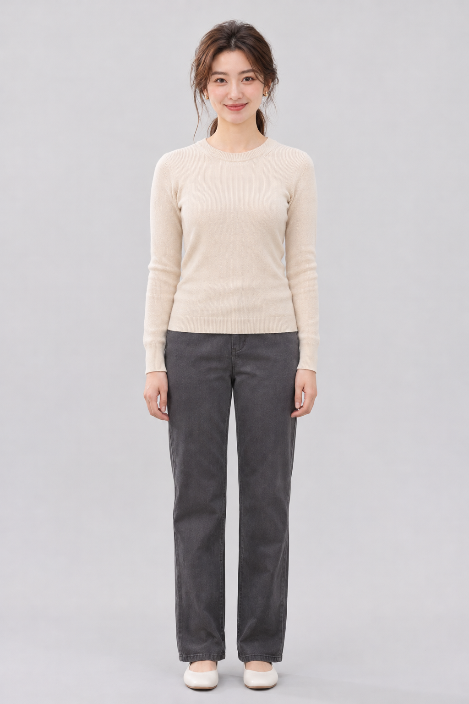
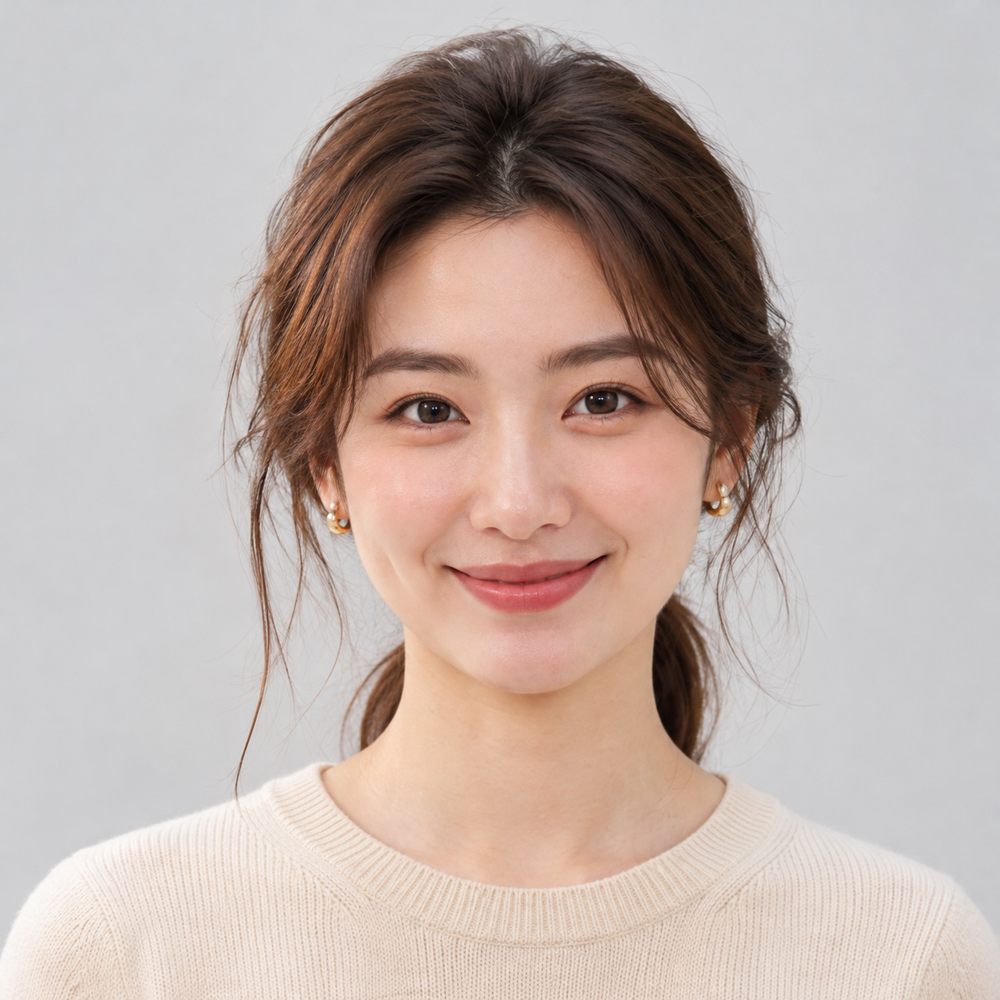
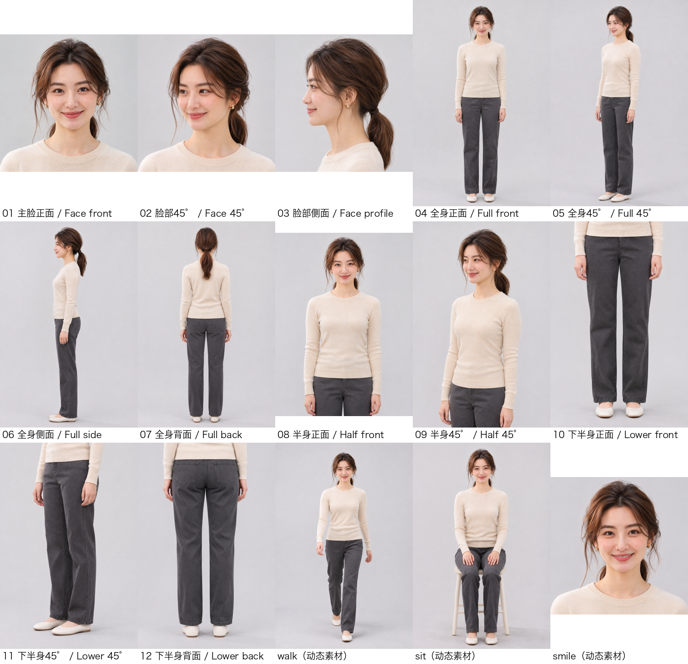
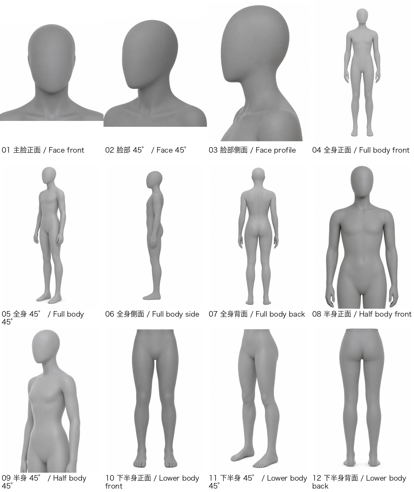

<div align="center">

# model-cast

### 为你的产品线，创建一位专属 AI 时尚模特。

从选角、身份确认，到可复用的模特视觉资料库。



**语宁 · 原创 AI 虚构模特**

</div>

model-cast 是一个开源 Skill，帮助用户创建原创成年虚构时尚模特，确认人物身份，并整理供后续 AI 工作流使用的视觉参考资料。

这里展示的是经授权公开的 AI 生成示例，不是真人照片。

---

## 从一张脸，建立完整的模特身份

<div align="center">


**面部身份参考**
</div>

模特不应该只是几张看起来相似的图片。model-cast 通过选角、身份确认和多视角整理，建立一套可反复调用的人物参考。

### C6 · 模特视觉资料



**12 个模特视角 · 3 个动作/表情示例**

C6 是整套资料的核心：面部身份、身体比例和已确认的模特视角都以真实模特图像表达。上方拼图用于快速浏览；实际工作时使用资料包中的独立原图。

---

## 为后续 AI 工作流准备的参考

标准 AI 资料库包含 16 张图像：

- **12 张**真实模特视角图
- **3 张**模特动作/表情示例
- **1 张**N2 灰色人偶镜头与构图参考

另附 `START-HERE.md` 使用说明和 `asset-index.json` 资料索引。需要轻量参考时，也可使用核心四图。

<details>
<summary><strong>N2 · 镜头与构图参考（展开查看）</strong></summary>



N2 使用灰色无脸 3D 人偶表达相机方向、观察角度、景别和裁切范围。它只负责镜头与构图，不代表模特身份，也不定义人物动作。
</details>

<details>
<summary><strong>C10 · 可选姿势参考（展开查看文件）</strong></summary>

C10 是独立的可选姿势补充，仅在 C6 没有展示所需姿势时使用。它不是标准 Skill 工作流阶段，不属于当前 16 张图片的资料库，也不进入 Lookset D2。

- [侧面行走 PNG](docs/assets/c10/C10-01-Walk-Side.png) · [SVG 源文件](docs/assets/c10/C10-01-Walk-Side.svg)
- [侧面坐姿 PNG](docs/assets/c10/C10-02-Sit-Side.png) · [SVG 源文件](docs/assets/c10/C10-02-Sit-Side.svg)
- [双手插兜 PNG](docs/assets/c10/C10-03-Hands-In-Pockets.png) · [SVG 源文件](docs/assets/c10/C10-03-Hands-In-Pockets.svg)

C6 负责人物身份与身体比例；C10 只表达动作和肢体位置。
</details>

---

## 从选角到资料交付

1. **选角** — 根据商品线和需求制定选角简报，比较候选模特。
2. **确认身份** — 由用户确认面部与身体参考，锁定人物身份。
3. **准备视角** — 整理模特角度和动作/表情资料，并进行商品小试。
4. **交付资料** — 构建中文、英文资料包及多文件 AI 参考库。

## 快速开始

```sh
git clone https://github.com/denggui-ai/model-cast.git
cd model-cast
python3 -m venv .venv
. .venv/bin/activate
python3 -m pip install -r requirements-dev.txt
shasum -a 256 -c SHA256SUMS
```

将 `skills/model-cast` 安装到受支持的 Agent Skill 目录。安装前请备份已有版本；仓库不会自动覆盖现有安装。

可以这样开始：

> 使用 model-cast 为我的产品线创建一位原创成年虚构时尚模特。请先检查输入并提出选角方案；在我批准之前不要生成图片。

生图由宿主提供的原生图像能力执行。本 Skill 不捆绑图像模型，也不提供生图额度；每次生成都需要相应权限和用户授权。

## 下游工作流与能力边界

**ChatGPT / Codex：** 将完整资料库目录 `4_完整AI资料库（多文件上传）` / `4_AI_Model_Library_MultiUpload` 中的文件一起上传。索引帮助 AI 选择当前任务所需的最少参考。AI 能识别附件，不代表下游图像工具一定收到了这些参考。ChatGPT 的 16/16 资产识别已有测试记录，但多参考独立控制身份尚未确证；Codex 本地文件夹到图像工具的端到端传递仍未验证。宿主无法传递时，应直接附加所选原图。

**Lookset D2：** 使用独立适配器，输入为 P3-2 身份参考、模特补充图 01–12 和 `model.json`。不要默认将 N2、C10 或普通用户说明加入 D2。Lookset 自行负责其姿势规划、服装编辑、摄影工作流和商业 QA。

model-cast 是模特创建与视觉参考交付工具，不是生图服务、虚拟试穿系统、服装设计工具或商业摄影流水线。最终图像生成、身份保持和服装还原效果取决于下游工具与实际工作流；自动化测试不能证明图像质量或商业结果。

### 公开仓库与专属资料包

本公开仓库包含 Skill、资料包构建工具、文档和公开展示资产。用户运行工作流后，可用自己确认的模特素材生成独立资料包。Owner 专属的 V3.0 卖家资料包是私有交付，不包含在本仓库中。C10 是 v0.2.0 发布后加入 `main` 的独立补充；v0.2.0 Release 和现有 V3.0 资料包均保持不变。

## 项目资源

- **正式源码 Release：** [v0.2.0](https://github.com/denggui-ai/model-cast/releases/tag/v0.2.0)
- [项目状态](docs/PROJECT-STATUS.md) · [Release 说明](docs/RELEASE-NOTES.md) · [公开 POC 结果](docs/POC-RESULTS.md)
- [C10 使用规范](docs/C10-USAGE.md) · [开发协议](docs/DEVELOPMENT-PROTOCOL.md) · [项目适配说明](docs/PROJECT-ADAPTER.md)
- [第三方许可声明](skills/model-cast/THIRD_PARTY_NOTICES.md)

自动化检查：

```sh
PYTHONDONTWRITEBYTECODE=1 python3 -m pytest -q -p no:cacheprovider
git diff --check
```

已验证项目快照的自动化测试为 242 项通过。完整工作流目前在 macOS 上验证；需要 Python 3.10+，且 `crop.py` 使用系统自带的 `sips` 工具。

## 许可证

原创项目代码和文档采用 MIT。Vendored Lookset 文件保留 Apache-2.0 及其上游声明。公开示例图片是经授权的 AI 生成项目资产；这不代表用户其他资产也获得相同授权。
